<div align="center">

# Riayati · رعايتي

**A mobile platform that protects children within custody, built for Algerian family law.**
Arabic-first, right-to-left. Incident reports with evidence, a shared visit calendar, and a legal assistant that answers only from cited sources.


[Live site](https://riayati.site) · [Admin demo screens](#admin-dashboard) · [Architecture](#architecture)

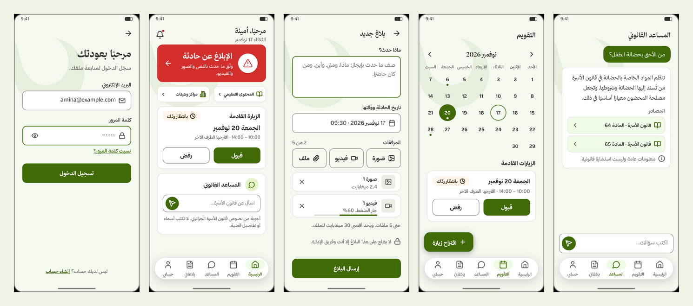

</div>

> The images in this README are renders of the UI design (FigCraft, mobile and admin, light and dark), not recordings of a running device.

## Why it exists

After a separation, parents often disagree about visits and about what happened during them. Riayati gives both parents one neutral place to record incidents with proof, agree on visit dates, and look up the family-law texts that apply, so that the child's interest stays the reference point.

## Features

| | |
|---|---|
| **Accounts** | Father and mother roles, secure token login, password reset, linking the two parents with an invitation code. A parent sees only their own data and the shared calendar. |
| **Incident reports** | Text, photos and video (compressed on the phone before upload), up to 5 files and about 30 MB each, exported as a structured Arabic PDF. Evidence lives in private storage behind short-lived signed URLs. |
| **Shared visit calendar** | Propose, accept, decline and confirm visits. Both parents see the same state. |
| **Legal assistant** | Retrieval-augmented answers built only from texts the admin enters. It cites the article, and says so when the sources are not enough, without calling the model. |
| **Library and centers** | Educational texts and a directory of support centers by wilaya. |
| **Admin dashboard** | Filament panel to receive and manage reports, edit legal texts (re-indexed automatically on save), manage centers, read users and visits, and review an activity log. |

## Screens

<table>
<tr>
<td>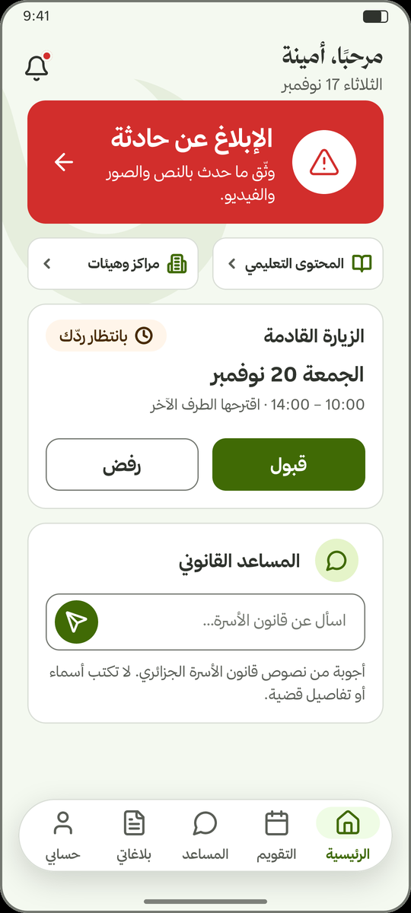</td>
<td>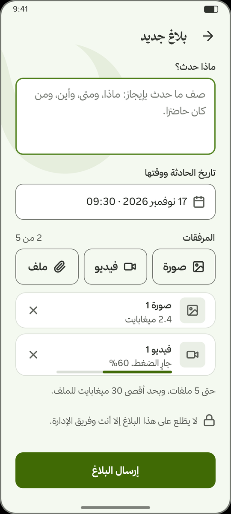</td>
<td>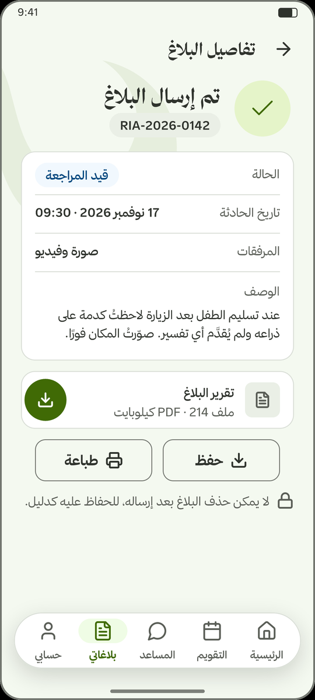</td>
<td>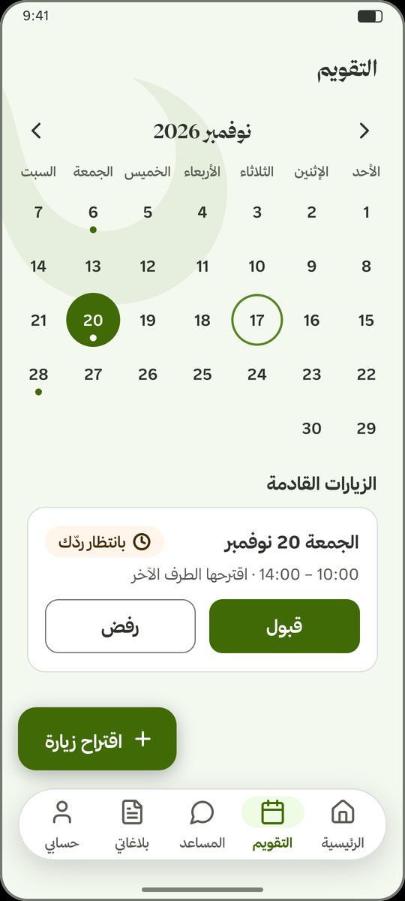</td>
</tr>
<tr>
<td align="center">Home</td><td align="center">New report</td><td align="center">Report summary</td><td align="center">Visit calendar</td>
</tr>
<tr>
<td>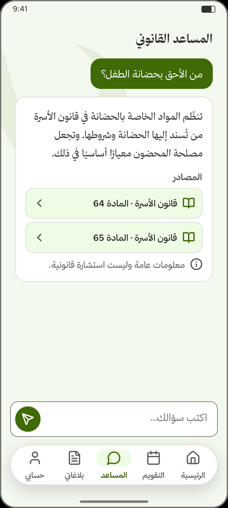</td>
<td>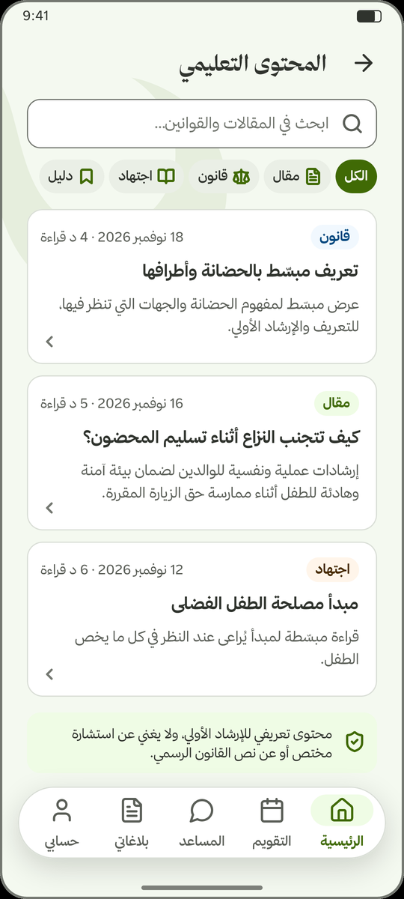</td>
<td>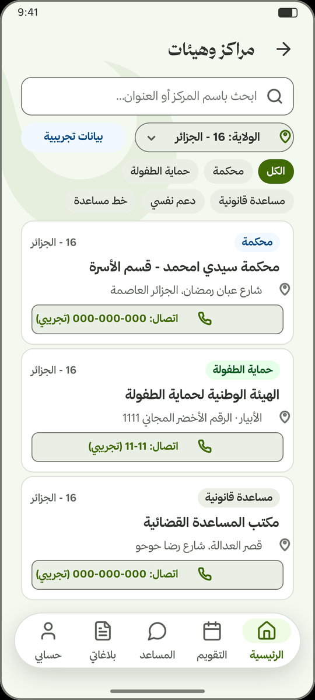</td>
<td>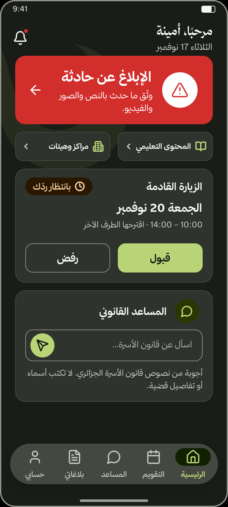</td>
</tr>
<tr>
<td align="center">Legal assistant</td><td align="center">Library</td><td align="center">Centers</td><td align="center">Dark mode</td>
</tr>
</table>

### Admin dashboard

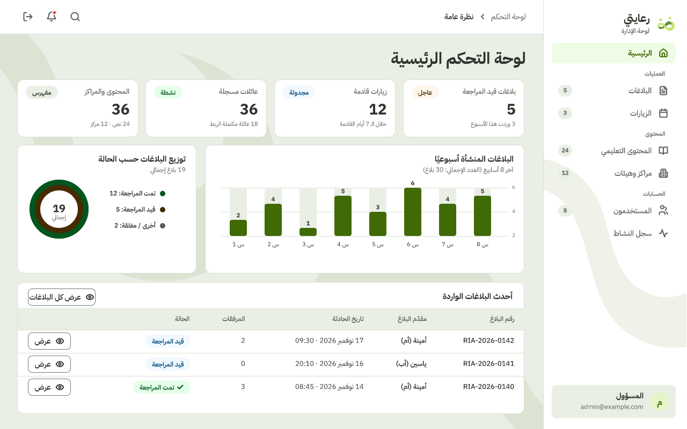

<table>
<tr>
<td>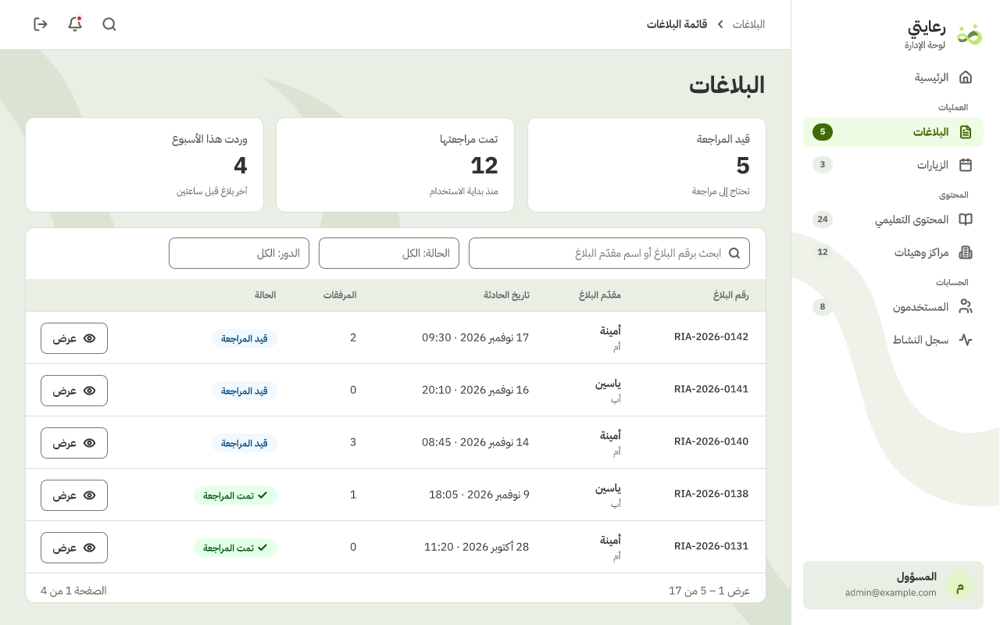</td>
<td>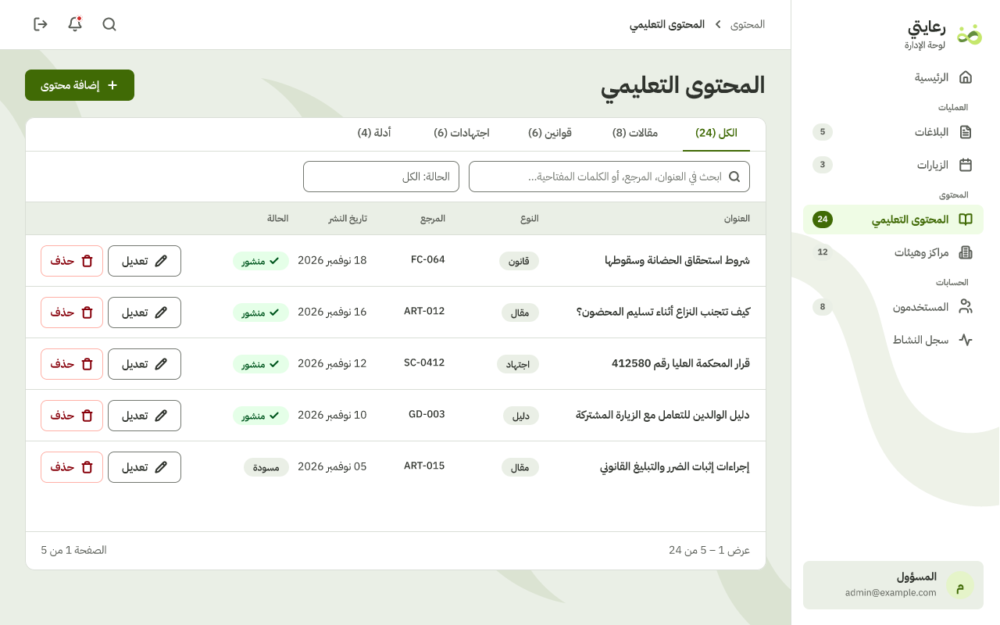</td>
</tr>
<tr>
<td align="center">Incident inbox</td><td align="center">Legal texts</td>
</tr>
</table>

## Architecture

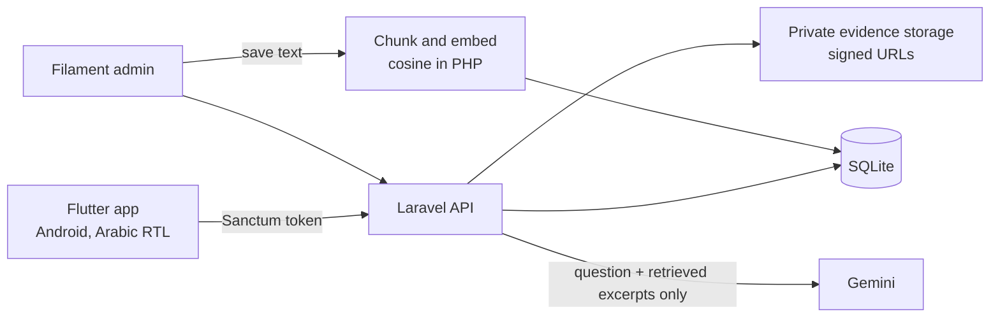

**Assistant pipeline.** Texts are split into chunks of about 900 characters with 150 overlap, embedded with `gemini-embedding-001` (768 dimensions) and stored in a SQLite table. A question is embedded, the top 4 chunks above a 0.55 cosine score are retrieved in PHP, and only the question and those excerpts go to the model. If nothing passes the threshold, a fixed "insufficient sources" answer is returned and the model is never called. Incident reports and personal data are never sent.

## Tech stack

- **Mobile:** Flutter, Riverpod, go_router, Dio, `flutter_secure_storage`; design tokens generated from `01-brand/tokens`.
- **Backend:** Laravel 13, Sanctum, policies per role, PHPUnit.
- **Admin:** Filament 5.
- **Data and AI:** SQLite, Gemini API (embeddings, answers).
- **Design:** FigCraft file with 17 pages, light and dark, driven headless from Python.
- **Marketing:** one-page landing, Remotion video kit.
- **Hosting:** shared hosting with PHP 8.3 over SSH, deployed with `tools/deploy-hostinger.ps1`.

## Repository layout

| Folder | What |
|---|---|
| `00-admin/` | Quote and contract documents |
| `01-brand/` | Logo, colors, design tokens (`tokens/`, generated by `generate_tokens.py`) |
| `02-design/` | HTML boards, the FigCraft document and the scripts that build it |
| `03-app/backend/` | Laravel API and Filament admin |
| `03-app/mobile/` | Flutter app |
| `05-marketing/` | Landing page and video kit |
| `docs/` | Deployment guide, admin guide, test report, client documents, screenshots |
| `tools/` | Deploy scripts and the design-tool bridge |

Decisions and status live in [`CLAUDE.md`](CLAUDE.md). API contract and build plan: [`03-app/PLAN.md`](03-app/PLAN.md).

## Run it locally

**Backend**
```bash
cd 03-app/backend
composer install
cp .env.example .env && php artisan key:generate
touch database/database.sqlite   # on Windows: create an empty file
php artisan migrate
php artisan test
php artisan serve
```

**Mobile**
```bash
cd 03-app/mobile
flutter pub get
flutter test
flutter run --dart-define=API_URL=http://10.0.2.2:8000/api   # Android emulator
```

The legal assistant needs `GEMINI_API_KEY` in `.env`. Without it the API answers 503 and the app shows a retry message.

**Design file** (headless, no FigCraft window)
```bash
FIGCRAFT_HEADLESS=1 python 02-design/figcraft/build_doc.py   # PowerShell: $env:FIGCRAFT_HEADLESS="1"
```

## Security and privacy decisions

- Evidence is private, served only through short-lived signed URLs; parents cannot delete submitted reports.
- The AI receives the question and public legal excerpts only, and the app warns users not to type names or case details.
- No secrets in the repository: `.env`, signing keys, databases and uploads are ignored.

## Not in this repository (on purpose)

- **thmanyah font files.** Their license forbids redistribution. Download them from <https://font.thmanyah.com> into `01-brand/fonts/thmanyah/` (see the README there). The design boards need them installed to render exactly.
- `tools/ux-ui-kit/` (third-party design kit): `npx ux-ui-agent-skills init`, then move it under `tools/ux-ui-kit/`.
- Secrets, signing keys and local files.

## Author

Built by **Yassine Grib** as a freelance project for a graduation start-up venture.
All rights reserved. The code is shown for portfolio purposes; ask before reusing it.
